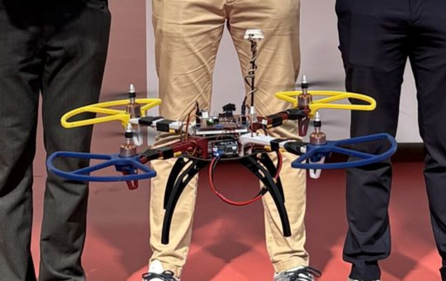
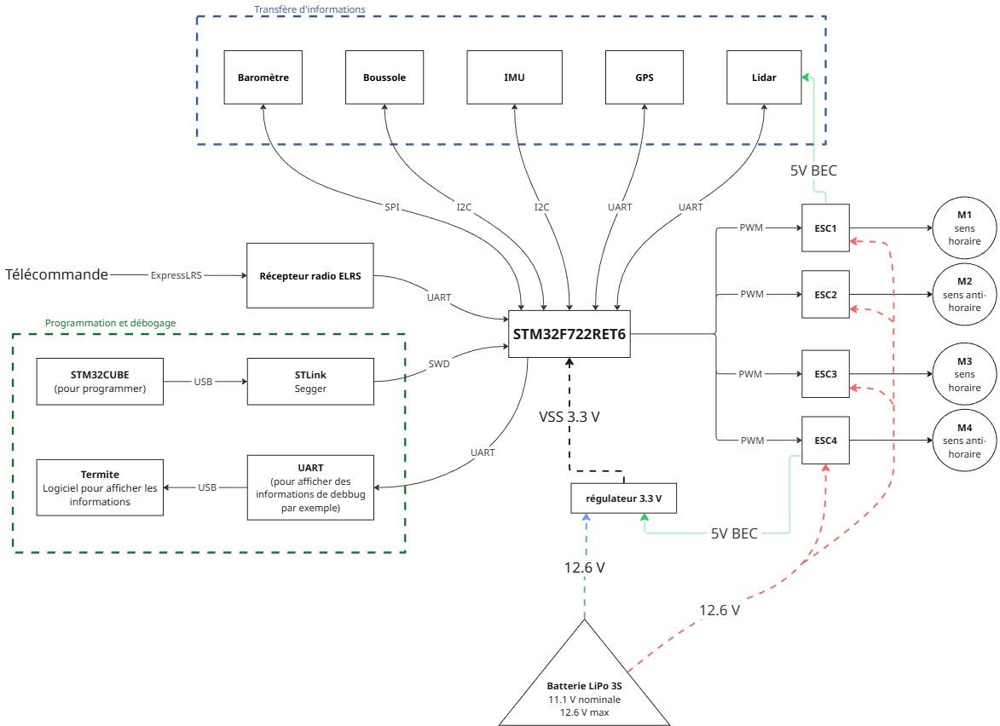
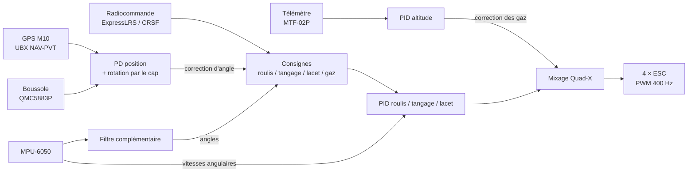
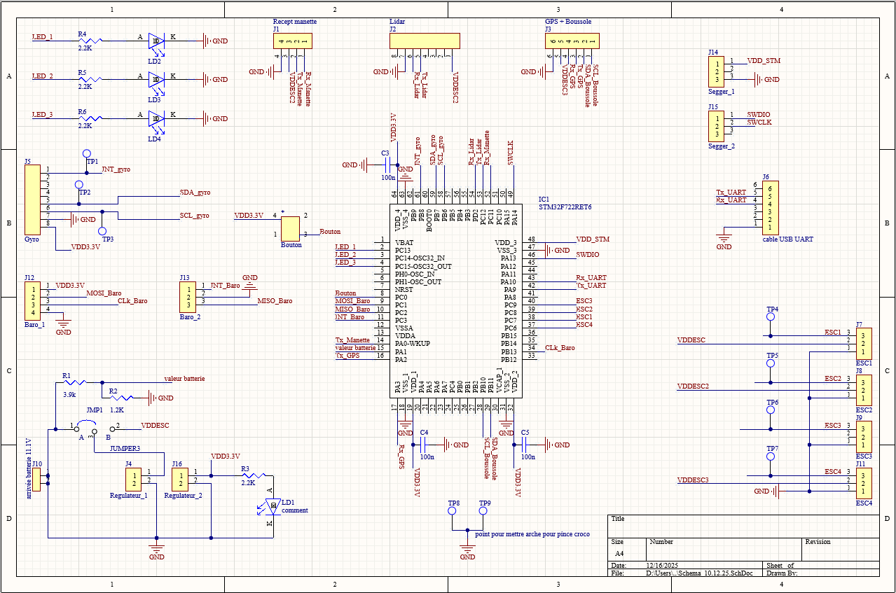
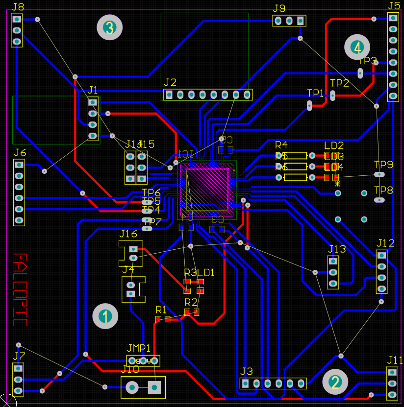
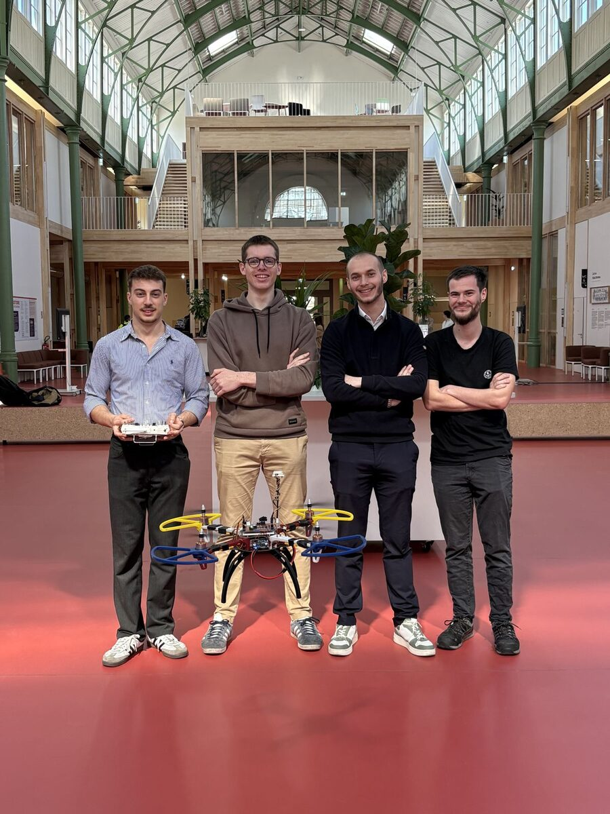

# Contrôleur de vol de quadricoptère — STM32F722 (FalcoPIC V2)


Contrôleur de vol conçu de A à Z pour un quadricoptère F450 : carte électronique sous Altium, firmware en C
sur STM32F722 (Cortex-M7 à 216 MHz avec FPU), stabilisation PID, maintien d'altitude par télémètre laser et
maintien de position GPS.

C'est la **deuxième version** du projet : la première tournait sur un PIC18 8 bits
([PIC18-Quadcop-FlightController](https://github.com/toxis31/PIC18-Quadcop-FlightController)).
Le passage au STM32 apporte le calcul flottant matériel, plus de périphériques et la marge nécessaire au vol assisté.

Projet de Master 1 à Junia ISEN Lille (novembre 2025 – avril 2026), réalisé en équipe de quatre.

> **Version publiée** : ce dépôt contient la dernière version du firmware partagée par l'équipe (V10).
> La version finale, développée sur un poste de l'école, intégrait en plus un filtre de Kalman pour l'estimation
> d'attitude ; elle n'a pas pu être récupérée.

<p align="center">
  
</p>

---

## Fonctionnalités

| Fonction | Implémentation |
|---|---|
| **Boucle de contrôle temps réel** | Interruption du timer TIM3 à **250 Hz** (période 4 ms) : tout le calcul de vol s'exécute dans l'ISR |
| **Estimation d'attitude** | MPU-6050 (±500 °/s, ±8 g, filtre matériel 42 Hz) + filtre passe-bas logiciel sur le gyroscope + **filtre complémentaire** gyro / accéléromètre avec transfert de lacet |
| **Stabilisation** | PID sur roulis, tangage et lacet, saturation ±400 µs, anti-emballement de l'intégrale au sol |
| **Commande moteurs** | TIM8, 4 canaux PWM à **400 Hz**, résolution 1 µs, plage 1000–2000 µs, mixage Quad-X, séquence de calibration des ESC au démarrage |
| **Radiocommande** | Récepteur **ExpressLRS**, protocole **CRSF** décodé à la main (UART 416 666 bauds, CRC-8, 16 voies 11 bits) |
| **Sécurité** | Armement par interrupteur, **failsafe** si aucune trame valide pendant 500 ms (désarmement, gaz coupés) |
| **Maintien d'altitude** | Télémètre laser du **MicoAir MTF-02P** (protocole Micolink), PID d'altitude autour des gaz de vol stationnaire, consigne réglable au manche (0,2 à 3 m) |
| **Maintien de position GPS** | u-blox M10 (trames **UBX NAV-PVT**), interpolation 5 Hz → 250 Hz, correcteur PD sur l'erreur de position, **rotation repère terrestre → repère drone** par le cap boussole |
| **Cap magnétique** | Boussole QMC5883P : calibration hard/soft-iron, moyenne glissante sur 10 échantillons |
| **Altitude barométrique** | LPS22HH à 75 Hz, formule hypsométrique, filtre passe-bas (mesure acquise, pas encore utilisée dans l'asservissement) |
| **Bus I²C non bloquant** | Boussole et baromètre lus en interruption sur I²C2, en alternance, pour ne jamais bloquer la boucle de 4 ms |

Le binaire fait **~36 Ko de flash et ~3,7 Ko de RAM** (compilé avec `arm-none-eabi-gcc -O2`, 0 avertissement).

---

## Architecture

<p align="center">
  
</p>

> Sur ce schéma de conception, le baromètre est encore relié en SPI : dans la version finale de la carte et du
> firmware, il partage le bus I²C2 avec la boussole.

### Boucles de commande



### Déroulement d'un cycle (toutes les 4 ms)

1. Mise à jour du failsafe et de l'état d'armement
2. Lancement en interruption de la lecture boussole ou baromètre (séquenceur I²C)
3. Interpolation de la position GPS
4. Lecture de l'IMU et calcul des angles (filtre complémentaire)
5. Si le maintien d'altitude est actif : PID d'altitude, qui remplace les gaz du pilote
6. Si le maintien de position est actif : PD GPS, qui incline le drone vers le point cible
7. PID roulis / tangage / lacet, puis mixage et écriture des 4 sorties PWM

Les trames des capteurs série (CRSF, Micolink, UBX) sont décodées octet par octet en interruption par des
machines à états, avec vérification de somme de contrôle.

---

## Matériel

| Fonction | Composant | Liaison |
|---|---|---|
| Microcontrôleur | STM32F722RET6 (Cortex-M7, 216 MHz, FPU simple précision) | — |
| Centrale inertielle | MPU-6050 | I²C1 |
| Boussole | QMC5883P (module HGLRC M100-5883) | I²C2 |
| Baromètre | LPS22HH | I²C2 |
| GPS | u-blox M10 (module HGLRC M100-5883) | USART2, UBX |
| Télémètre + flux optique | MicoAir MTF-02P | UART5, Micolink |
| Récepteur radio | ExpressLRS 2,4 GHz | UART4, CRSF |
| Propulsion | Châssis F450, moteurs A2212 1000 KV, hélices 1045, ESC 30 A | PWM TIM8 |
| Alimentation | LiPo 3S (11,1 V), convertisseur abaisseur vers 3,3 V | — |

### Brochage

| Broche | Fonction | Signal |
|---|---|---|
| PB6 / PB7 | I²C1 SCL / SDA | MPU-6050 |
| PB10 / PB11 | I²C2 SCL / SDA | Boussole + baromètre |
| PA0 / PC11 | UART4 TX / RX | Récepteur ExpressLRS |
| PC12 / PD2 | UART5 TX / RX | MTF-02P |
| PA2 / PA3 | USART2 TX / RX | GPS |
| PC6 – PC9 | TIM8 CH1 – CH4 | ESC 1 à 4 |
| PC13 | GPIO | LED « armé » |
| PC14 | GPIO | LED « initialisation terminée » |

### Carte électronique

Carte porteuse conçue sous Altium Designer : le STM32 est soudé sur la carte, les capteurs et la radio sont des
modules raccordés par connecteurs. Un cavalier permet de choisir la source d'alimentation (BEC 5 V des ESC ou
batterie 12 V), et un régulateur à découpage remplace le régulateur linéaire pour éviter les pertes thermiques.

| Schéma électrique | Routage du PCB |
|---|---|
|  |  |

Ces images correspondent à une révision intermédiaire (décembre 2025). Les fichiers sources de la version finale
sont dans [`hardware/altium/`](hardware/altium) et la nomenclature dans [`hardware/BOM.md`](hardware/BOM.md).

---

## Réglages

| Boucle | Kp | Ki | Kd | Saturation |
|---|---|---|---|---|
| Roulis / tangage (vitesse angulaire) | 1,3 | 0,025 | 18 | ±400 µs |
| Lacet | 4,0 | 0,02 | 0 | ±400 µs |
| Altitude (télémètre) | 0,2 | 0,0001 | 5 | ±150 µs |
| Position GPS | 1,0 | — | 5 | ±150 |

### Voies de la radiocommande

| Voie | Rôle |
|---|---|
| 1 à 4 | Lacet, tangage, gaz, roulis |
| 5 | Armement (> 1700 µs) |
| 6 | Maintien d'altitude (> 1700 µs) |
| 7 | Maintien de position GPS (> 1700 µs, fix 3D requis) |

---

## Compilation

**Avec STM32CubeIDE** : *File → Import → Existing Projects into Workspace*, sélectionner le dossier
`firmware/`, puis *Build*. Le fichier `F7_PID_V10.ioc` permet de régénérer la configuration avec STM32CubeMX
(paquet STM32Cube FW_F7 V1.17.4).

**En ligne de commande** (vérification rapide) :

```bash
cd firmware
FLAGS="-mcpu=cortex-m7 -mfpu=fpv5-sp-d16 -mfloat-abi=hard -mthumb -O2 \
  -DUSE_HAL_DRIVER -DSTM32F722xx -ICore/Inc -IDrivers/STM32F7xx_HAL_Driver/Inc \
  -IDrivers/STM32F7xx_HAL_Driver/Inc/Legacy -IDrivers/CMSIS/Device/ST/STM32F7xx/Include \
  -IDrivers/CMSIS/Include -ffunction-sections -fdata-sections"
arm-none-eabi-gcc $FLAGS Core/Src/*.c Drivers/STM32F7xx_HAL_Driver/Src/*.c \
  Core/Startup/startup_stm32f722retx.s -T STM32F722RETX_FLASH.ld \
  --specs=nano.specs -Wl,--gc-sections -lm -o drone.elf
```

Programmation par SWD (sonde ST-Link ou Segger J-Link).

> ⚠️ **Sécurité** : toujours retirer les hélices pour les essais sur table, et régler les PID sur un banc
> qui empêche le drone de décoller.

---

## Structure du dépôt

```
firmware/
  Core/Src/main.c        Boucle 250 Hz, PID, mixage, maintien d'altitude et de position
  Core/Src/mpu.c         MPU-6050 : calibration, filtres, angles
  Core/Src/elrs.c        Décodeur CRSF (ExpressLRS) et failsafe
  Core/Src/mtf.c         Décodeur Micolink (MTF-02P) : distance et flux optique
  Core/Src/gps.c         Décodeur UBX NAV-PVT et interpolation
  Core/Src/boussole.c    QMC5883P : calibration et calcul du cap
  Core/Src/barometre.c   LPS22HH : pression, température, altitude
  Core/Src/pwm.c         Sorties ESC et séquence de calibration
  Drivers/               HAL et CMSIS STMicroelectronics (non modifiés)
hardware/
  altium/                Schéma, PCB et librairie Altium (version finale)
  BOM.md                 Nomenclature de la carte
docs/                    Architecture, schéma et PCB en images
media/                   Photos du drone
```

---

## Limites connues et pistes d'amélioration

- **Flux optique** : les vitesses du MTF-02P sont décodées mais pas encore utilisées. Prochaine étape : une boucle
  de vitesse horizontale pour tenir la position en intérieur, sans GPS.
- **Point GPS** : la cible du maintien de position est codée en dur dans `main.c`. Il faudra la mémoriser à
  l'activation, puis gérer une liste de points de passage.
- **Baromètre** : l'altitude est mesurée mais pas encore fusionnée avec le télémètre, qui reste limité à
  quelques mètres.
- **Réglages** : les gains et les calibrations sont des constantes ; un réglage par la télémétrie éviterait de
  recompiler.
- **Filtrage** : cette version (V10) utilise le filtre complémentaire. Le filtre de Kalman de la version finale,
  comparé au filtre complémentaire sur des données IMU enregistrées, est à réintégrer dans ce dépôt.

---

## Équipe

Projet de Master 1 — Junia ISEN Lille, encadré par M. Jean-Marc Capron.

- Théo David
- Loïc Fortin
- Thomas Chochoy
- Thomas Cotdeloup

### Ma contribution (Thomas Cotdeloup)

J'ai développé le firmware à deux avec Thomas Chochoy, en intervenant sur l'ensemble du code. J'ai plus
particulièrement pris en charge :

- **GPS** : décodeur du protocole UBX (trames NAV-PVT), interpolation 5 Hz → 250 Hz et maintien de position
  (correcteur PD, rotation du repère terrestre vers le repère drone par le cap boussole) ;
- **Télémètre et flux optique** : décodeur Micolink du MTF-02P et maintien d'altitude ;
- **PID** : boucles roulis / tangage / lacet et altitude, réglage des gains en vol ;
- **Commande des moteurs** : génération PWM des ESC et séquence de calibration.

<p align="center">
  
</p>
